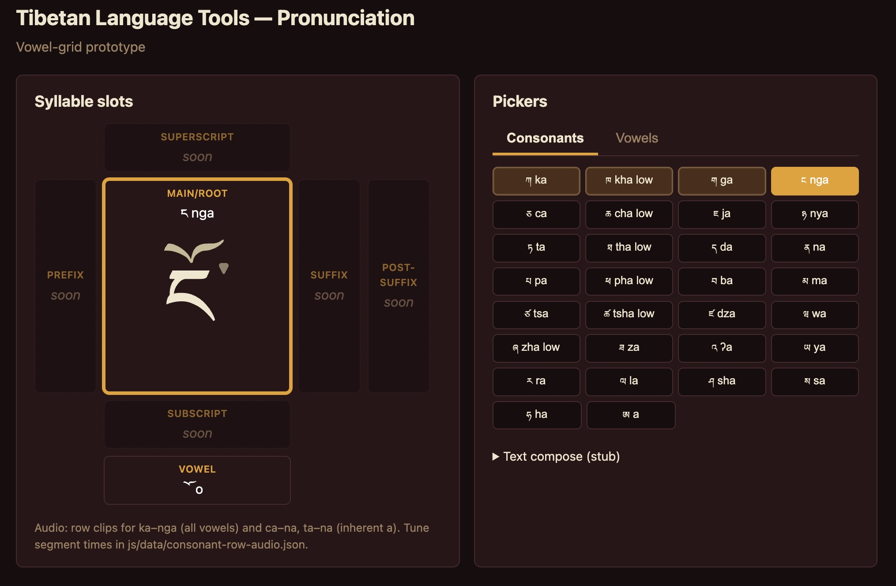

# TLT Pronunciation

Browser-only tool for **standard Central Tibetan** syllable preview: consonant + vowel glyphs, layout tuning, and pronunciation audio (v0).



## Requirements

- **Node.js** (for dev/build)
- **Python 3** (optional static preview without Vite)

Serve from the **repo root** (not `file://`).

## Quick start

From the repository root:

```bash
npm install
npm run dev
```

Open the URL Vite prints (default [http://127.0.0.1:3030](http://127.0.0.1:3030)).

## Scripts

| Command | Purpose |
|---------|---------|
| `npm run dev` | Vite dev server + HMR |
| `npm run build` | Production bundle → `dist/` |
| `npm run preview:vite` | Serve `dist/` |
| `npm run preview` | Static server from repo root (port `3030`, or set `PORT`) |

After clone, if glyphs/audio 404 in dev, ensure `public/assets` → `../assets` exists:

```bash
ln -sfn ../assets public/assets
```

## What's in the repo

| Area | Notes |
|------|--------|
| `index.html`, `css/`, `js/` | App shell, glyph grid, pickers, audio |
| `assets/svg/` | Sliced consonants/vowels/marks + source charts (CC BY-SA; see footer in app) |
| `assets/audio/` | Row clips + optional master; segment times in `js/data/consonant-row-audio.json` |
| `js/data/glyph-layout.json` | Layout numbers (edit → full reload in dev) |

**Query param:** `?shad=1` shows shad for crossbar alignment checks.

**Stubs (not wired):** text compose (`js/composer.js`), placement rules (`js/rules/placement.js`).

## Deploy

Static upload: ship `index.html`, `css/`, `js/`, and `assets/` with the same relative paths (or use `dist/` after `npm run build`).

## Context for contributors

Planning and handoff live outside this repo — see [PROJECT.md](./PROJECT.md).